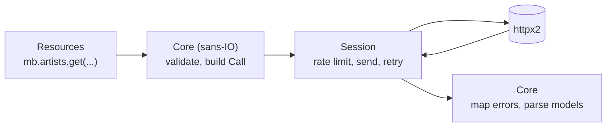

# Development

## Setup

The project uses [uv](https://docs.astral.sh/uv/):

```sh
uv sync
```

## Checks

```sh
uv run pytest                 # tests; offline, about a second
uv run pytest --cov           # with branch coverage
uv run ruff check .           # lint
uv run ruff format .          # format
uv run ty check               # type check
uv run zensical serve         # this documentation, live-reloading
```

The tests never touch the network: they swap in `httpx2.MockTransport` through
the client's `transport=` argument. Shared helpers live in
`tests/_support.py`.

## Architecture



The request logic is **sans-IO**: `_core.py` turns every method call into a
`Call` (method, path, parameters, body, and a function that parses the
response) and maps responses to models or exceptions, without doing any
networking. The clients in `client.py` only execute calls. A sync and an async
session each handle rate limiting, retries and logging.

This keeps `MusicBrainz` and `AsyncMusicBrainz` identical in behaviour, and
lets most logic be tested without a client at all (`tests/test_core.py`).

| Module | Contents |
|---|---|
| `_constants.py` | Entity names, includes, browse links and filter values. |
| `_core.py` | Validation, request building, response and error parsing. |
| `client.py` | Sync and async clients, sessions and entity namespaces. |
| `models.py` | Pydantic models and `Page`. |
| `errors.py` | Exception hierarchy. |
| `query.py` | Lucene query helpers. |
| `_ratelimit.py` | Sync and async rate limiters. |
| `cli.py` | The Typer command-line interface. |

## Documentation

These pages are built with [Zensical](https://zensical.org/) from `docs/`;
the API reference is generated from docstrings by mkdocstrings. Docstrings
use the Google style (`Args:`, `Returns:`, `Raises:`), and cross-references
are written as `` [`Name`][musicbrainz.module.Name] ``.

```sh
uv run zensical build   # output in site/
```
