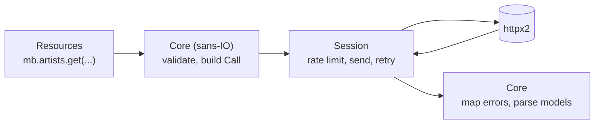

# Development

## Setup

The project uses [uv](https://docs.astral.sh/uv/):

```sh
uv sync
```

The library supports Python 3.12 and later; development uses the version in
`.python-version`. To run the tests on 3.12 too:

```sh
uv run --isolated --python 3.12 pytest
```

## Checks

```sh
uv run pytest                 # tests; offline, about a second
uv run pytest --cov           # with branch coverage
uv run ruff check .           # lint
uv run ruff format .          # format
uv run ty check               # type check
uv run zensical serve         # this documentation, live-reloading
```

The tests never touch the network: they swap in `httpx2.MockTransport` through
the client's `transport=` argument. Shared helpers live in
`tests/_support.py`.

### Recorded responses

`tests/fixtures/` holds real responses from musicbrainz.org and the Cover Art
Archive. `tests/test_fixtures.py` parses each one exactly as the client would
and checks that it converts back to the original JSON, so a field the models
mistype or drop fails a test. The only differences allowed are two deliberate
conversions where the API itself is inconsistent: Cover Art Archive image IDs
become strings, and place coordinates from search results become numbers.

Refresh them occasionally to catch API changes (about 40 seconds, because of
the rate limit):

```sh
uv run python scripts/record_fixtures.py
```

The script builds every request with the library's own `Core`, and
`tests/fixtures/manifest.json` records how, so the tests replay the same
requests.

### Weekly API compatibility check

The recorded responses only prove the models match the API as it was when they
were recorded. `.github/workflows/api-check.yml` checks the live services every
Monday (and on demand from the Actions tab):

```sh
uv run python scripts/record_fixtures.py --check --report report.md
```

It fetches the same requests fresh and runs them through the same round-trip
comparison as the tests (`scripts/roundtrip.py`), without touching
`tests/fixtures/`. It checks compatibility, not data: new releases, ratings or
counts never fail it.

| Outcome | Exit | What the workflow does |
|---|---|---|
| Every response round-trips | 0 | Closes the open `api-compatibility` issue, if any. |
| A response no longer parses, loses or changes data, or a request is rejected (4xx) | 1 | Opens the `api-compatibility` issue with the report, or updates it, and fails the run. |
| The service is down, overloaded or rate-limiting (5xx, 429, network) | 2 | Fails the run without touching issues. |

Fields the API sends that the models don't define yet are listed in the report
as *new fields*, but aren't failures: the models keep them in `model_extra`.
When the check reports something worth keeping, update the models and re-record
the fixtures.

GitHub disables scheduled workflows in public repositories after 60 days
without activity; re-enable it from the Actions tab if that happens.

## Architecture



The request logic is **sans-IO**: `_core.py` turns every method call into a
`Call` (method, path, parameters, body, and a function that parses the
response) and maps responses to models or exceptions, without doing any
networking. The clients in `client.py` only execute calls. A sync and an async
session each handle rate limiting, retries and logging.

This keeps `MusicBrainz` and `AsyncMusicBrainz` identical in behaviour, and
lets most logic be tested without a client at all (`tests/test_core.py`).

| Module | Contents |
|---|---|
| `_constants.py` | Entity names, includes, browse links and filter values. |
| `_core.py` | Validation, request building, response and error parsing. |
| `client.py` | Sync and async clients, sessions and entity namespaces. |
| `models.py` | Pydantic models and `Page`. |
| `errors.py` | Exception hierarchy. |
| `query.py` | Lucene query helpers. |
| `_ratelimit.py` | Sync and async rate limiters. |
| `cli.py` | The Typer command-line interface. |
| `examples/` | Runnable example scripts; `tests/test_examples.py` checks they import and run `--help`. |
| `scripts/record_fixtures.py` | Records the real responses used by the tests. |

## Documentation

These pages are built with [Zensical](https://zensical.org/) from `docs/`;
the API reference is generated from docstrings by mkdocstrings. Docstrings
use the Google style (`Args:`, `Returns:`, `Raises:`), and cross-references
are written as `` [`Name`][pymusicbrainz.module.Name] ``. Ruff enforces both
docstring presence and Google style (the `D` rules with
`convention = "google"`), and the `DOC` rules check the sections against the
code: every value returned needs `Returns:`, and `Raises:` must list exactly
what the function itself raises. Exceptions that only propagate from a call
(such as `NotFoundError` from a request) are mentioned in the description
instead. Tests are exempt from needing docstrings.

Constructor arguments are documented in the `__init__` docstring (PEP 257),
not on the class: the class docstring describes what the class is, and
`__init__` lists its `Args:` and `Raises:`. The reference pages still show
them together (mkdocstrings' `merge_init_into_class`), and editors show the
`__init__` docstring while you type a constructor call. An alternative
constructor would be a `@classmethod` with its own `Args:`.

```sh
uv run zensical build   # output in site/
```

The docs tools are in their own `docs` dependency group (included in `dev`).
`.github/workflows/docs.yml` builds the site with just that group and
publishes it to GitHub Pages on every push to `main`. It needs a one-time
repository setting: **Settings → Pages → Source: GitHub Actions**.

## Contributing

Changes land on `main` through pull requests, which are **squash-merged**: the
pull request title becomes the commit message on `main`, and from there the
changelog entry and the version bump. So the title must be a [conventional
commit](https://www.conventionalcommits.org/), which `pr-title.yml` checks:

| Title | Changelog section | Version bump |
|---|---|---|
| `feat: add a cover art CLI` | Added | minor |
| `fix(search): handle empty pages` | Fixed | patch |
| `perf: …`, `refactor: …`, `security: …`, `deps: …`, `build: …`, `revert: …` | Performance, Changed, … | patch |
| `feat!: …` or a `BREAKING CHANGE:` footer | marked **Breaking** | major |
| `docs: …`, `test: …`, `ci: …`, `chore: …`, `style: …` | not listed | none |

Every pull request runs `tests.yml`: ruff, ty and the docs build, then the
test suite on Python 3.12–3.15.

## Releasing

Releases go through a pull request, so the version bump and the changelog are
reviewed like any other change:

1. **Every push to `main`** runs `release.yml`. It runs the tests, then asks
   [git-cliff](https://git-cliff.org/) for the next version. If anything since
   the last tag warrants a release, it rebuilds the branch `release/next` from
   `main` with a single commit, `chore(release): vX.Y.Z`, which writes the
   version into `pyproject.toml` and `uv.lock` (`uv version`) and regenerates
   `CHANGELOG.md`. It then opens or updates the release pull request, whose
   description is that version's release notes. If nothing warrants a
   release, it closes the release pull request.
2. **Merging the release pull request** is the release. Its squash commit on
   `main` (`chore(release): vX.Y.Z (#N)`) makes `release.yml` push the tag
   `vX.Y.Z` instead, and start `publish.yml` for it.
3. **`publish.yml`** runs the tests again, checks that the tag matches the
   project version, builds the wheel and sdist, creates the GitHub release with
   the notes and the files, and uploads to PyPI with trusted publishing.

To try the publishing path without releasing, run **Actions → Publish → Run
workflow** with `testpypi`: it builds the current branch and uploads it to
TestPyPI (a version TestPyPI already has is skipped).

Preview locally what the release pull request would contain:

```sh
uvx git-cliff@2.14.2 --bumped-version                 # its version
uvx git-cliff@2.14.2 --bump --unreleased --output -   # its changelog section
```

Never edit `CHANGELOG.md` or the version by hand: to fix a changelog line, fix
the pull request title (or, after merging, the commit) it came from.

The workflows push with their own `GITHUB_TOKEN`. Pushes made with it start no
other workflows, so `release.yml` explicitly dispatches `tests.yml` for the
release pull request and `publish.yml` for the tag.
