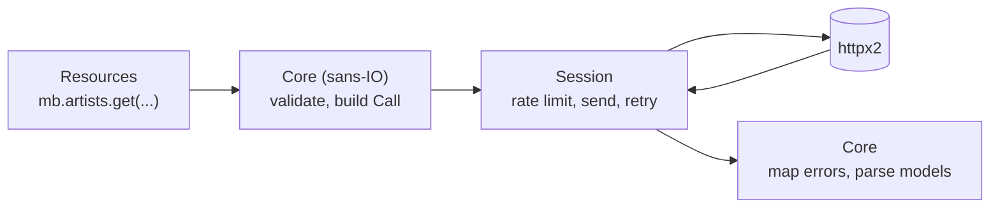

# Development

## Setup

The project uses [uv](https://docs.astral.sh/uv/):

```sh
uv sync
```

The library supports Python 3.12 and later; development uses the version in
`.python-version`. To run the tests on 3.12 too:

```sh
uv run --isolated --python 3.12 pytest
```

## Checks

```sh
uv run pytest                 # tests; offline, about a second
uv run pytest --cov           # with branch coverage
uv run ruff check .           # lint
uv run ruff format .          # format
uv run ty check               # type check
uv run zensical serve         # this documentation, live-reloading
```

The tests never touch the network: they swap in `httpx2.MockTransport` through
the client's `transport=` argument. Shared helpers live in
`tests/_support.py`.

### Recorded responses

`tests/fixtures/` holds real responses from musicbrainz.org and the Cover Art
Archive. `tests/test_fixtures.py` parses each one exactly as the client would
and checks that it converts back to the original JSON, so a field the models
mistype or drop fails a test. The only differences allowed are two deliberate
conversions where the API itself is inconsistent: Cover Art Archive image IDs
become strings, and place coordinates from search results become numbers.

Refresh them occasionally to catch API changes (about 40 seconds, because of
the rate limit):

```sh
uv run python scripts/record_fixtures.py
```

The script builds every request with the library's own `Core`, and
`tests/fixtures/manifest.json` records how, so the tests replay the same
requests.

## Architecture



The request logic is **sans-IO**: `_core.py` turns every method call into a
`Call` (method, path, parameters, body, and a function that parses the
response) and maps responses to models or exceptions, without doing any
networking. The clients in `client.py` only execute calls. A sync and an async
session each handle rate limiting, retries and logging.

This keeps `MusicBrainz` and `AsyncMusicBrainz` identical in behaviour, and
lets most logic be tested without a client at all (`tests/test_core.py`).

| Module | Contents |
|---|---|
| `_constants.py` | Entity names, includes, browse links and filter values. |
| `_core.py` | Validation, request building, response and error parsing. |
| `client.py` | Sync and async clients, sessions and entity namespaces. |
| `models.py` | Pydantic models and `Page`. |
| `errors.py` | Exception hierarchy. |
| `query.py` | Lucene query helpers. |
| `_ratelimit.py` | Sync and async rate limiters. |
| `cli.py` | The Typer command-line interface. |
| `examples/` | Runnable example scripts; `tests/test_examples.py` checks they import and run `--help`. |
| `scripts/record_fixtures.py` | Records the real responses used by the tests. |

## Documentation

These pages are built with [Zensical](https://zensical.org/) from `docs/`;
the API reference is generated from docstrings by mkdocstrings. Docstrings
use the Google style (`Args:`, `Returns:`, `Raises:`), and cross-references
are written as `` [`Name`][pymusicbrainz.module.Name] ``. Ruff enforces both
docstring presence and Google style (the `D` rules with
`convention = "google"`); tests are exempt from needing docstrings.

Constructor arguments are documented in the `__init__` docstring (PEP 257),
not on the class: the class docstring describes what the class is, and
`__init__` lists its `Args:` and `Raises:`. The reference pages still show
them together (mkdocstrings' `merge_init_into_class`), and editors show the
`__init__` docstring while you type a constructor call. An alternative
constructor would be a `@classmethod` with its own `Args:`.

```sh
uv run zensical build   # output in site/
```

The docs tools are in their own `docs` dependency group (included in `dev`).
`.github/workflows/docs.yml` builds the site with just that group and
publishes it to GitHub Pages on every push to `main`. It needs a one-time
repository setting: **Settings → Pages → Source: GitHub Actions**.
